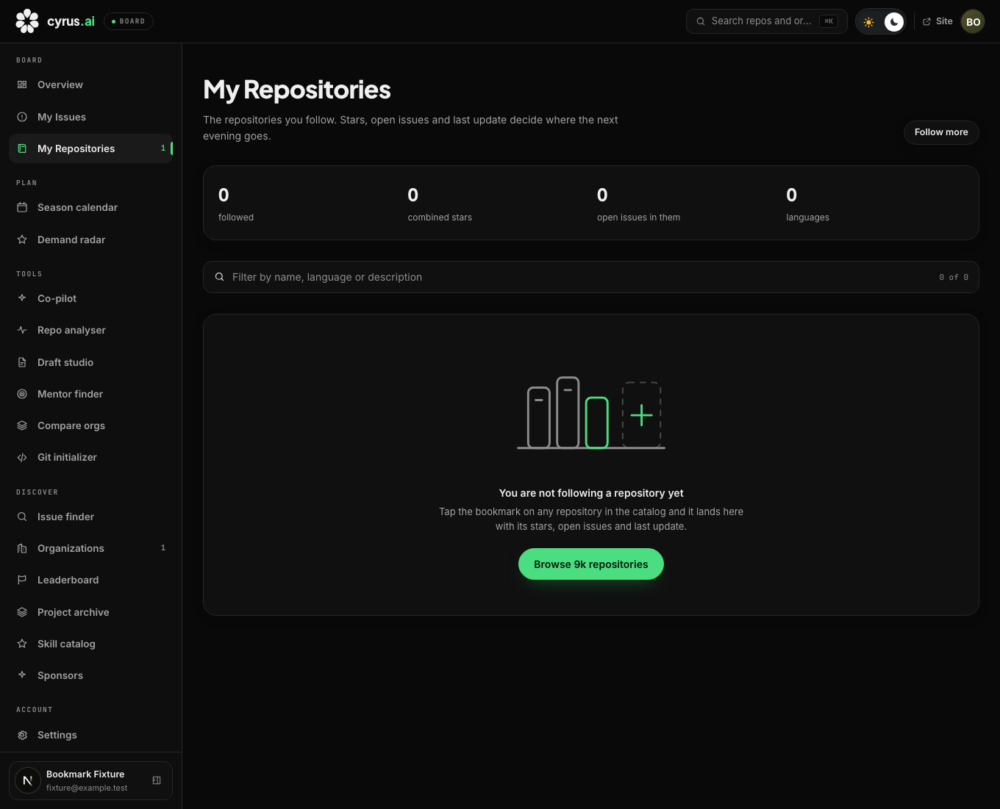
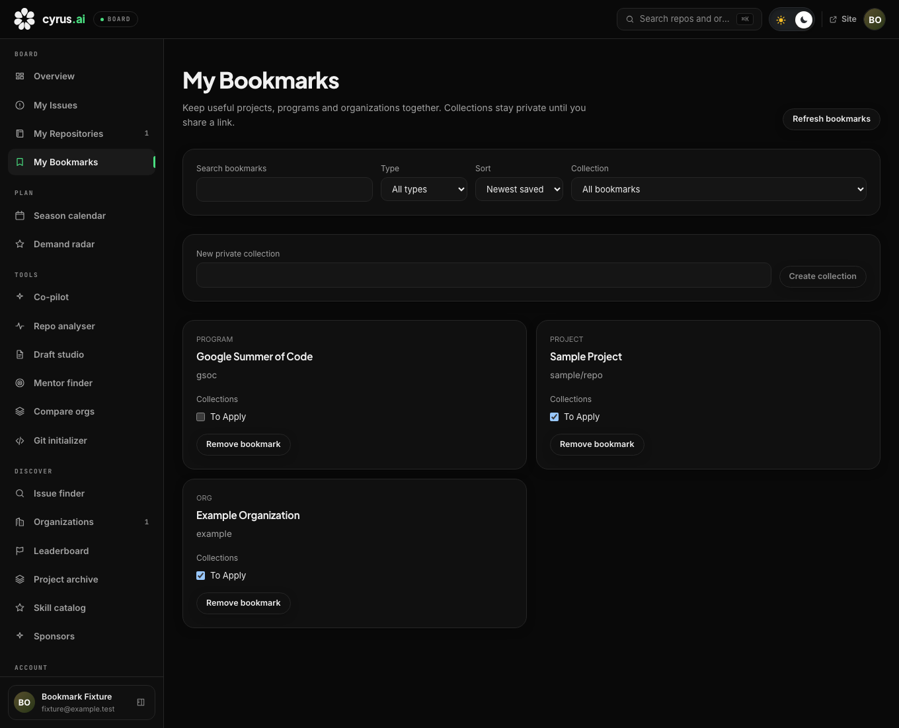
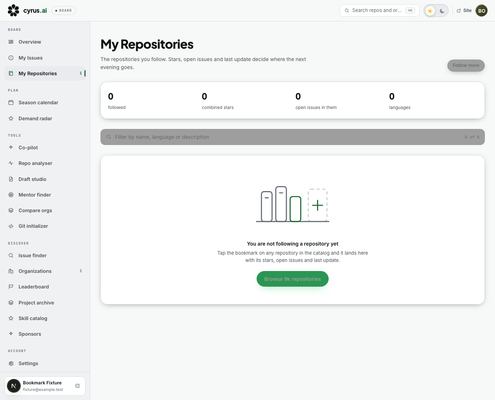
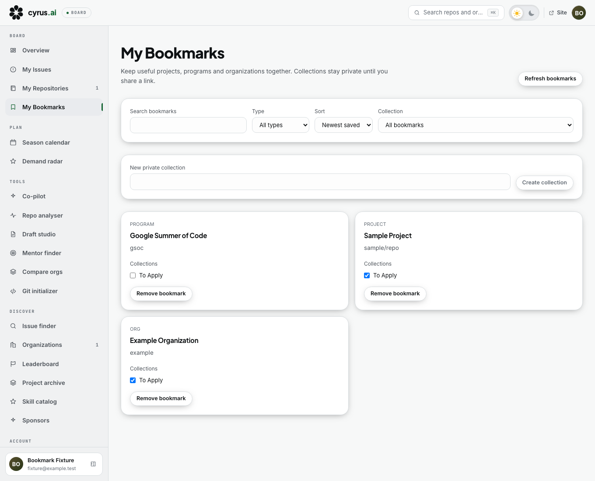
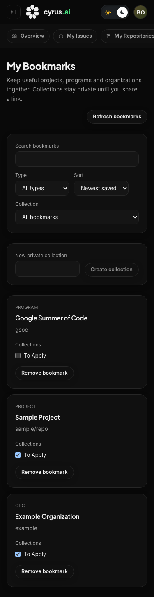
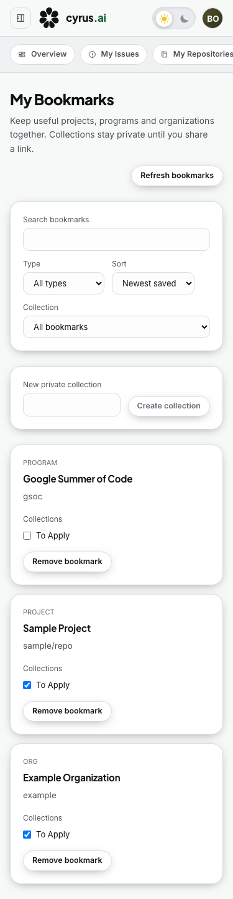

# Bookmark collections review evidence

Actual browser captures of main `6230cba` before the feature, and the normal production build of `7fc1e4f` afterward. Fictional users and records only; no production database or authentication keys.

The application uses its actual signed-cookie auth, Next Server Actions and Neon HTTP driver. A temporary local-only HTTP adapter directs the synthetic fixture endpoint to owned, in-memory PostgreSQL (PGlite). Public avatar images and Vercel telemetry are omitted from the fixture. This is browser acceptance of the local application, not a production deployment test.

- Typecheck, 758 tests across 58 files, README check and production build passed.
- 15 new tests cover PostgreSQL ownership/foreign keys/cascades, signed sessions, sharing/revocation, filters and ordered optimistic rollback.
- Development and production flows passed with two users and two browser contexts, stale cross-device state, save/member failure recovery, and an old read held until after a successful mutation.
- Native keyboard membership controls, 80-character collection names and widths 320, 375, 430, 850 and 1360 passed. Final light/dark desktop/mobile captures were visually reviewed.
- Full migration chain remains blocked: main's journal references absent `0002_mysterious_hawkeye.sql` and its snapshot. Tests apply available 0000/0001 plus the additive bookmark migration; they do not establish full-chain deployment readiness. Restore/reconcile 0002, then regenerate 0003 metadata and test the full chain before marking the source PR ready.

| Before | After |
| --- | --- |
|  |  |
|  |  |

| Mobile dark | Mobile light |
| --- | --- |
|  |  |
